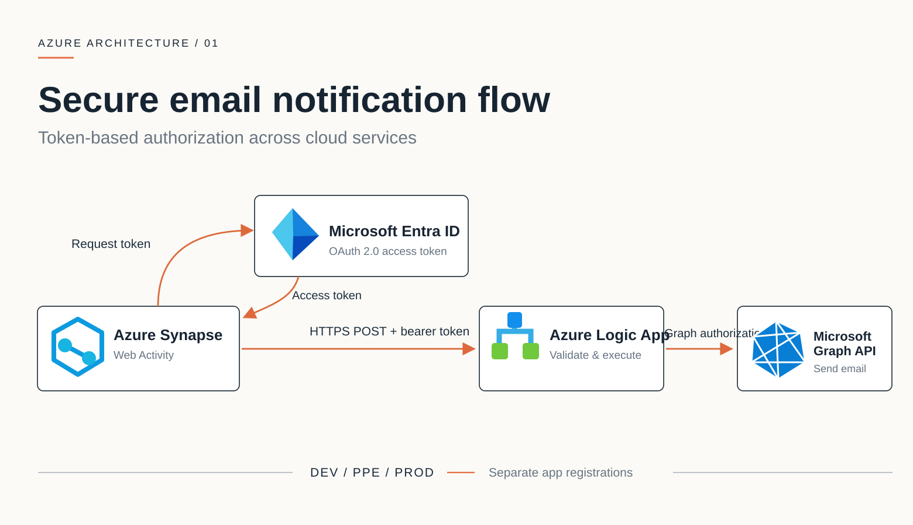

# Azure Cloud Modernization

Modernizing legacy SQL and PowerShell workflows with Azure Logic Apps, Synapse Analytics, Microsoft Entra ID, Microsoft Graph, Bicep and CI/CD.

## Secure email notification architecture

**How it works**

1. **Azure Synapse** obtains an OAuth 2.0 access token from **Microsoft Entra ID** using a configured identity.
2. The Synapse **Web Activity** sends an HTTPS POST request with the bearer token to **Azure Logic Apps**.
3. The Logic App validates the incoming request, runs its workflow and uses separately authorized credentials/identity to call **Microsoft Graph API**.
4. Microsoft Graph sends the email from the configured sender mailbox.

Development, PPE and production use separate application registrations in this reference scenario.

> **Note:** The diagram is a conceptual representation, not a claim that one token works for both the Logic App endpoint and Microsoft Graph. Each API requires an appropriately issued token and granted permissions.

## Authenticating Synapse to a Logic App: Managed identity vs. SAS

### What is OAuth 2.0?

**OAuth 2.0 is an authorization framework that enables an application to obtain an access token and use it to access protected resources or services with defined permissions.** It allows access to be granted without sharing the resource owner's password with the calling application. OAuth 2.0 is primarily about **authorization**; user authentication is a separate concern, commonly handled by OpenID Connect (OIDC) when user sign-in is needed.

In this Azure integration, **Synapse uses its managed identity to request an OAuth 2.0 access token from Microsoft Entra ID**. The Synapse Web Activity sends that token to the Logic App, which must validate it and enforce its configured authorization policy before allowing the workflow to run. Managed identity provides the application's Azure identity; OAuth 2.0 provides the token-based authorization mechanism.

When an **Azure Synapse pipeline Web Activity** calls a **Logic App HTTP Request trigger**, two common authorization approaches are:

| | Managed identity (recommended) | Shared access signature (SAS) |
|---|---|---|
| How the request is authorized | Synapse's managed identity obtains a Microsoft Entra ID OAuth 2.0 bearer token; the Logic App validates it against its inbound authorization configuration. | The request uses a signed Logic App callback URL containing a SAS signature (typically a `sig` query parameter). |
| Secret handling | No static signing key needs to be stored or passed in pipeline configuration. | The signed URL acts like a secret: anyone who obtains a valid URL may be able to invoke the workflow. |
| Rotation and maintenance | Azure manages the identity credentials and token lifecycle. | Signed URLs/keys must be protected and rotated when compromised or as required by policy. |
| Access control | Authorization can be restricted using Microsoft Entra token claims and an appropriately configured audience/policy. | Authorization is based on possession of the valid signed URL, with additional controls possible. |
| Best fit | Production integrations where identity-based authorization and least privilege are priorities. | Simpler integrations or compatibility scenarios where SAS is explicitly acceptable and protected. |

**Recommendation: Use the Synapse workspace managed identity with Microsoft Entra ID OAuth 2.0 for the inbound Logic App request.** This avoids exposing a reusable signature in pipeline definitions, logs, shared URLs, or configuration, reduces secret-rotation work, and enables identity-based access policies. A managed identity **does not automatically authorize** the call: the Logic App must be configured to accept and validate the token, and the Synapse Web Activity must request a token for the correct audience.

For a **Consumption** Logic App with an HTTP Request trigger, configure an inbound Microsoft Entra authorization policy that checks the relevant token claims. Select **Managed Identity** in the Synapse Web Activity authentication settings, use the workspace identity, and configure its **Resource/audience** to match the intended token recipient. Where supported and appropriate, disable SAS authentication on the Consumption request trigger so the signed URL cannot also be used. For **Standard** Logic Apps, inbound Microsoft Entra authentication is configured differently (for example, using App Service Authentication / Easy Auth); confirm the hosting model before implementation.

**Important:** A single inbound call must use **either** an OAuth bearer token **or** a SAS signature, **not both**. Adding OAuth authorization to a signed callback URL that still contains the SAS `sig` parameter is not a valid way to combine the schemes. Configuring one scheme does not necessarily disable the other for future separate calls; explicitly disable SAS where the Logic App hosting model supports that requirement.

If SAS is used, treat the entire callback URL as a credential: never commit it, avoid writing it to logs, store it securely (for example, in Azure Key Vault), and rotate it if exposed.

> **Scope:** This section covers authentication **from Synapse into the Logic App trigger**. Authentication **from the Logic App to Microsoft Graph** is a separate hop with its own identity, token audience, and permissions.

**Microsoft documentation:** [Secure access to Logic Apps](https://learn.microsoft.com/en-us/azure/logic-apps/logic-apps-securing-a-logic-app) · [HTTP Request trigger security](https://learn.microsoft.com/en-us/azure/connectors/connectors-native-reqres)

## Documentation

- [Azure fundamentals: Bicep and JSON objects](docs/azure-fundamentals.md)
- [Logic App deployment with existing build and release pipelines](docs/logic-app-cicd-deployment.md)

## Security

Examples here are independently recreated and sanitized. Do not commit internal endpoints, secrets, access signatures, employer source code or organization-specific settings.
