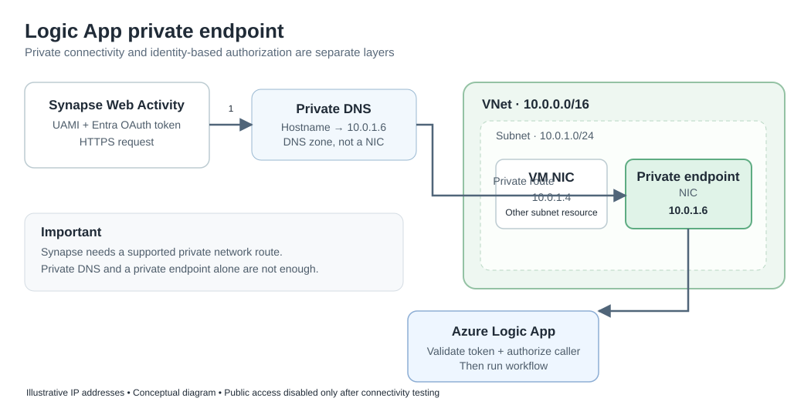

# Logic App private endpoint: VNet, NIC, DNS, and Synapse

> Learning example: the addresses below are illustrative, not production configuration. This describes a **proposed** network design, not an already deployed change.

## The idea in one sentence

A private endpoint gives a **Standard Logic App** a private IP in a subnet; private DNS resolves its usual hostname to that IP for correctly configured clients, and network connectivity plus Microsoft Entra authentication are both needed to invoke the workflow.

## What lives where?

- **VNet**: An isolated Azure networking boundary with a defined address space, such as `10.0.0.0/16`.
- **Subnet**: A segment of that address space, such as `10.0.1.0/24`. The subnet hosts private endpoint IP allocations and VM network interfaces.
- **NIC**: A network interface belonging to a particular resource. For example, a VM may have a NIC at `10.0.1.4`; the Logic App **private endpoint** has its own managed NIC and an illustrative private IP of `10.0.1.6`. The Logic App itself is **not a VM deployed in that subnet**.
- **Private endpoint**: A private network entry point that maps an IP in the selected subnet to the supported Azure service. It does not replace token-based authorization.
- **Private DNS**: For an App Service-hosted Standard Logic App, the `privatelink.azurewebsites.net` DNS zone, linked to the appropriate VNet, is commonly used to resolve the application hostname to its private endpoint IP. Clients still use the normal HTTPS hostname, not the private IP as an HTTP Host header. DNS is a service/zone, **not another NIC**.

## Request flow

1. The **Synapse Web Activity** prepares an HTTPS POST to the Logic App's normal trigger URL and acquires an OAuth token using its configured user-assigned managed identity.
2. From the network where the activity executes, **DNS resolves** the Logic App hostname via the private DNS configuration to the private endpoint IP (for example `10.0.1.6`).
3. Network routing and a **supported integration runtime/compute networking arrangement** allow the request to reach the private endpoint NIC. A Synapse managed private endpoint alone does not guarantee that every Web Activity uses that path.
4. The private endpoint forwards connectivity to the **Logic App service**. The endpoint does not perform Microsoft Entra token authentication.
5. The Logic App inbound authentication/authorization configuration validates the token's issuer, audience and permitted caller; only then can the workflow run.
6. After end-to-end testing, **disable public network access** on the Logic App if the deployment supports the intended private-only operation.

## Before versus proposed

| Concern | Current | Proposed |
|---|---|---|
| Inbound network | Publicly reachable endpoint | Private endpoint and public access disabled |
| DNS | Public DNS resolves public reachability | Private DNS resolves the same hostname to the private IP for designated networks |
| Caller authorization | UAMI / Entra bearer token validated | Keep the same token validation |
| Access prerequisite | Network path + correct authorization | **Private** network path + correct authorization |

## Practical checks

- Confirm **Standard Logic App**, hosting/network capabilities, selected subnet, private endpoint approval, and correct private DNS zone linkage.
- Determine where the **Synapse Web Activity actually runs**; use a supported integration runtime that can resolve and route to the private IP. A caller inside the VNet (e.g., a VM) illustrates networking only and does not imply Synapse runs on that VM.
- Validate DNS using the **normal Logic App hostname** from the actual runtime path and verify HTTPS access with a valid OAuth token.
- Verify that unauthorized tokens fail from the private network and that callers without private connectivity cannot invoke the trigger after public access is disabled.
- Evaluate deployment, monitoring, and portal access requirements, plus any necessary separate private endpoints or SCM endpoints.
- Keep in mind this is **inbound** connectivity. The Logic App's outbound request to Microsoft Graph requires its own identity, permissions and network access.

**Useful Microsoft documentation:** [Private endpoints for single-tenant Logic Apps](https://learn.microsoft.com/en-us/azure/logic-apps/secure-single-tenant-workflow-virtual-network-private-endpoint) · [Azure private endpoint DNS configuration](https://learn.microsoft.com/en-us/azure/private-link/private-endpoint-dns) · [Secure Logic Apps](https://learn.microsoft.com/en-us/azure/logic-apps/logic-apps-securing-a-logic-app)

## Key takeaway

**A VNet contains subnets; NICs belong to resources and obtain IP addresses from subnets.** The private endpoint NIC gives a Logic App a private network entry point. Private DNS finds that IP, connectivity reaches it, and **Entra authorization still decides whether the workflow may run**.
