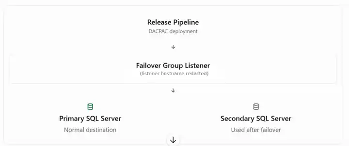

# Middle-tier migration to Azure SQL — DACPAC deployment and failover

The middle-tier database modernization includes deploying the database schema to Azure SQL through a release pipeline. The illustration below shows the **Azure SQL failover group listener** used as the deployment connection endpoint.

*Illustrative screenshot of the deployment flow. The specific listener hostname has been redacted.*

## What is a DACPAC?

A **DACPAC** is a package containing the **structure (schema) of a SQL database**—such as tables, views, and stored procedures. It helps deploy or update that structure in Azure SQL consistently.

**In this project:** The build pipeline creates the DACPAC, and the release pipeline uses it to deploy database schema changes to Azure SQL through the failover group listener.

**Remember:** A DACPAC is for **database structure**, not for copying the table data itself. Data migration and reconciliation are separate tasks.

## How the deployment works

1. The **release pipeline** runs a DACPAC deployment to apply approved database schema changes.
2. The connection uses the **failover group listener DNS name**, rather than a hard-coded primary SQL server hostname.
3. The listener directs the connection to the **current primary** SQL server for the failover group.
4. If failover occurs and the secondary becomes the new primary, the same listener name can route a new connection to that server after DNS and failover state update.

**Why use the listener?** It avoids tying the deployment connection string to one physical SQL server and supports continuity when the primary role changes.

**Important:** This is an architecture explanation, not proof that failover has been tested. The release identity still needs appropriate database/network permissions; the target database must exist and be accessible. DACPAC deployment must target the writable primary, and the team should separately validate failover-group replication, deployment retry behavior, and post-failover connectivity. No production server names, secrets, or connection strings are included.
