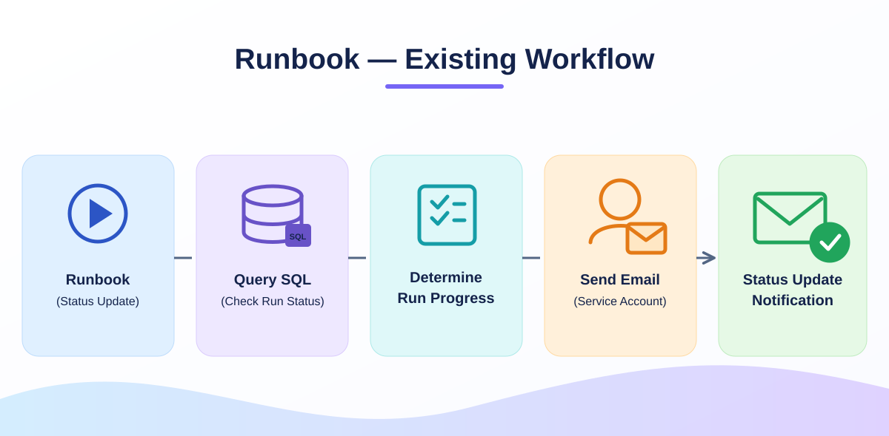

# Runbook status-email modernization

**Status: In progress — discovery and implementation details pending.**

## Purpose

This is a separate workstream from the Synapse pipeline-to-Logic App modernization. The goal is to retain automated run-status reporting while modernizing the identity and sender mailbox used for email notifications.

## Existing process (high level)



1. A status-update automation runbook runs.
2. The runbook queries SQL to determine the current progress or status of a run.
3. It constructs a status notification and sends an email.
4. The current email delivery flow uses a service account.

```text
Status-update runbook
        |
        v
SQL run-status query
        |
        v
Build status notification
        |
        v
Existing service-account-based email sending
        |
        v
Recipients
```

## Proposed change

Replace the existing service-account-based email-sending arrangement with an approved **shared mailbox sender** while preserving the run-status checks and status notification behavior.

**Important:** A shared mailbox is the sender identity/address; it is **not automatically a replacement for the credentials used to authenticate to Microsoft Graph or another mail service**. The final design must specify the caller identity, required email-sending permissions (such as Microsoft Graph `Mail.Send`, if Graph is used), Exchange mailbox access controls, and the approved authorization method. Prefer managed identity or another approved workload identity where supported rather than storing a shared-mailbox password.

## Details to capture next

- Runbook entry point, execution schedule/triggers, and related scripts or shared utilities (sanitized).
- SQL status query/procedure, return fields, and definition of each run status.
- Current mail-sending function, how it authenticates, and where the service account is referenced.
- Intended shared mailbox, approved sending identity, mailbox permissions, and Graph/API flow (use placeholders in this repository).
- Example success, in-progress, and failure notification payloads and recipient-handling rules.
- Retry/error handling, logging, monitoring, and validation evidence for Dev/PPE/Prod.
- Deployment and rollback steps, including how the old account dependency will be retired.

## Success criteria

- SQL status lookup continues to report correct progress.
- Notification content and recipients remain correct.
- Emails are sent using the approved shared mailbox **and** properly authorized sending identity.
- Unauthorized sends fail; no long-lived credentials are committed or logged.
- Runbook failures are observable and migration can be rolled back safely.

> This is a sanitized project plan. No runbook code changes or production account migration are claimed here.
